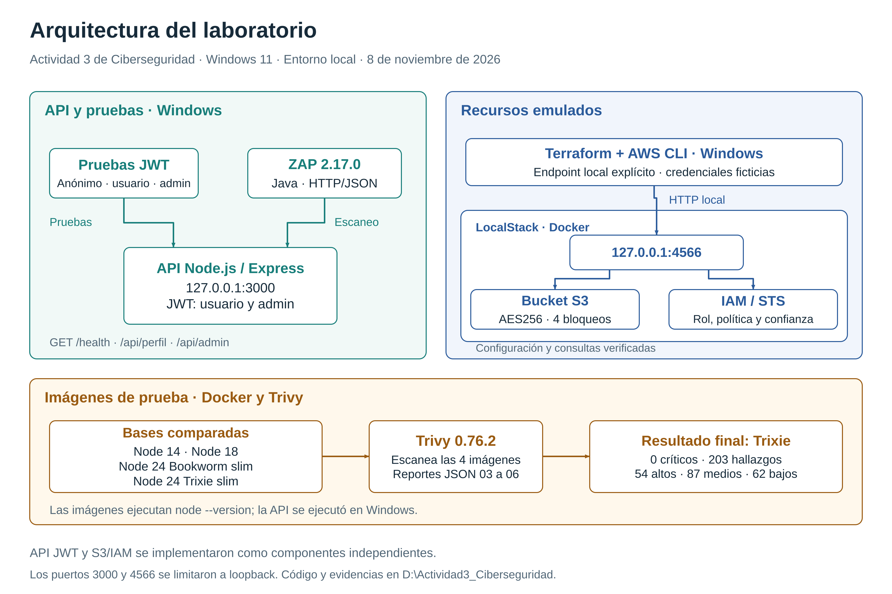

# Actividad 3 de Ciberseguridad

Laboratorio académico en Windows para comprobar autenticación JWT, permisos por rol, configuración segura de S3 emulado y análisis de seguridad. Utiliza LocalStack; no requiere una cuenta real de AWS.

**Nombre:** [NOMBRE] · **Matrícula:** [MATRÍCULA]

## Componentes y requisitos

- **Página y API:** Node.js 24.13.0, Express 5.3.0 y jsonwebtoken 9.0.3. Interfaz en español, adaptable, con consultas reales y JWT solo en memoria.
- **Infraestructura:** Docker Desktop, LocalStack y Terraform 1.17.1; proveedor AWS fijado en 6.72.0. El código admite Terraform `>= 1.17.0, < 2.0.0`.
- **Comprobaciones adicionales:** AWS CLI, Trivy 0.76.2 y ZAP 2.17.0 con Java 17. Las versiones y la preparación están en la [guía de Windows](docs/GUIA_WINDOWS.md).

La API se ejecuta directamente en Windows. LocalStack emula S3, IAM, STS y S3 Control dentro de Docker. Son flujos independientes: la API devuelve datos simulados y no accede al bucket.

## Iniciar la página y la API

En PowerShell, con Node.js instalado:

```powershell
Set-Location 'D:\Actividad3_Ciberseguridad\API'
npm ci
if (-not (Test-Path -LiteralPath '.env')) {
    node -e "require('node:fs').writeFileSync('.env', 'ACTIVIDAD3_JWT_SECRET=' + require('node:crypto').randomBytes(64).toString('hex') + '\n', {flag:'wx'})"
}
node --env-file=.env index.js
```

Abre **http://127.0.0.1:3000/**. Mantén esa terminal abierta; `Ctrl+C` detiene la API. Si ya está funcionando, utiliza la instancia existente. La clave local no debe publicarse ni sustituirse mientras haya tokens en uso.

### Probar los permisos

| Ruta GET | Sin JWT válido | Usuario | Administrador |
|---|---:|---:|---:|
| `/health` | 200 | 200 | 200 |
| `/api/perfil` | 401 | 200 | 200 |
| `/api/admin` | 401 | 403 | 200 |

Los botones muestran ruta, código HTTP, respuesta y explicación. El token se borra al salir o pulsar **Borrar token**; no se guarda en cookies, almacenamiento del navegador ni URL. La firma, vigencia, emisor, audiencia y rol se validan en el servidor.

Para generar un JWT de cinco minutos, abre otra terminal de PowerShell en `API/`:

```powershell
$rol = 'usuario' # Cambia a 'admin' para probar administracion
node --env-file=.env -e "const rol=process.argv[1]; console.log(require('jsonwebtoken').sign({rol}, process.env.ACTIVIDAD3_JWT_SECRET, {algorithm:'HS256',issuer:'actividad3',audience:'actividad3-api',subject:'demo-'+rol,expiresIn:'5m'}))" $rol
```

Copia únicamente el JWT al campo de la página, sin `Bearer`. No lo incluyas en capturas o reportes. Este comando es local; la API no expone una ruta de emisión de tokens.

### Ejecutar las pruebas

Con la API en ejecución, desde `API/`:

```powershell
node pruebas-sitio.cjs
```

Comprueba la API y ejecuta el JavaScript real de la página con un DOM mínimo. Genera un informe nuevo en `Reportes/Nuevas/`, sin imprimir ni guardar claves o tokens. La prueba histórica `pruebas-jwt.js` se conserva y evita sobrescribir su reporte original.

## Iniciar LocalStack y Terraform

Inicia Docker Desktop con el motor Linux. Desde la raíz del proyecto:

```powershell
if (-not (Test-Path -LiteralPath '.\LocalStack\.env')) {
    Copy-Item -LiteralPath '.\LocalStack\.env.example' -Destination '.\LocalStack\.env'
}
notepad .\LocalStack\.env
```

Introduce tu token de LocalStack en ese archivo privado; conserva el valor si ya estaba configurado. Después:

```powershell
docker compose --env-file .\LocalStack\.env -f .\LocalStack\compose.yaml up -d
Invoke-RestMethod -Uri 'http://127.0.0.1:4566/_localstack/health'
terraform -chdir=Terraform init
terraform -chdir=Terraform validate
terraform -chdir=Terraform plan
terraform -chdir=Terraform apply
```

Revisa el plan antes de confirmar `apply`. Las credenciales AWS `test` son ficticias y los endpoints apuntan a LocalStack. Las instrucciones de S3, IAM, contenedores y ZAP están en la [guía de Windows](docs/GUIA_WINDOWS.md).

## Organización

| Carpeta | Contenido |
|---|---|
| [API](API/) | API, pruebas, archivos de bloqueo y página en `public/` |
| [LocalStack](LocalStack/) y [Terraform](Terraform/) | Compose, recursos S3 y bloqueo del proveedor |
| [IAM](IAM/) | Política de lectura y confianza del rol |
| [Contenedores](Contenedores/) | Cuatro Dockerfiles de comparación |
| [ZAP](ZAP/) | OpenAPI y planes originales de análisis |
| [Reportes](Reportes/README.md) | Resultados propios, antecedentes y comprobaciones nuevas |
| [Diagrama](Diagrama/) y [Documento](Documento/) | Diagramas editables, PNG e informes académicos |
| [docs](docs/) | Ejecución detallada y revisión de los archivos publicables |

Se conservan las carpetas originales para mantener válidas las rutas del laboratorio y de los documentos. Los scripts ZAP originales están preparados para `D:\Actividad3_Ciberseguridad`.



El diagrama registra la arquitectura del 8 de noviembre. La página añadida utiliza la misma API local. También se conservan los [controles de acceso](Diagrama/02_Controles_Acceso.png) y el [editable Draw.io](Diagrama/Diagramas_Actividad3.drawio).

## Resultados y limitaciones

- **Históricos:** 10/10 pruebas JWT; tres contextos válidos de ZAP con cero alertas HTTP/JSON; S3 con AES256 y cuatro bloqueos públicos; configuración IAM consultada.
- **Trivy final:** Node 24 Trixie, cero críticos, 54 altos, 87 medios y 62 bajos. Se conservan los análisis de Node 14 y Node 18.
- **Página y API, 10 de noviembre de 2026:** 44 pruebas correctas: 31 de HTTP real, 8 del cliente con API real y 5 simuladas. Se revisó la página en computadora y celular.

Los informes completos, fechas y alcance están en [Reportes](Reportes/README.md). Las pruebas nuevas no acreditan una nueva ejecución de Terraform, LocalStack, Trivy o ZAP.

LocalStack no tiene persistencia configurada; al recrearlo puede perder sus recursos. El plan utilizado no permitió demostrar denegaciones efectivas de IAM. Los análisis anteriores de ZAP no cubren la página nueva ni DOM XSS. Node 18 mantuvo críticos y Node 24 se añadió como mitigación; su aceptación frente a la rúbrica corresponde al profesor. No se encontró la rúbrica original entre los archivos.

## Archivos excluidos

El [.gitignore](.gitignore) excluye secretos, `.env`, claves, dependencias, herramientas instaladas, sesiones privadas, estados y planes de Terraform, respaldos y resultados nuevos sin revisar. Conserva `package-lock.json`, `.terraform.lock.hcl` y plantillas `.env.example` sin credenciales. Consulta la [revisión de publicación](docs/PUBLICACION.md).

La organización del README toma como referencia [Sarloo/Actividad3_Ciberseguridad](https://github.com/Sarloo/Actividad3_Ciberseguridad). El código, diseño, resultados y evidencias de este proyecto corresponden a los archivos propios del laboratorio.
